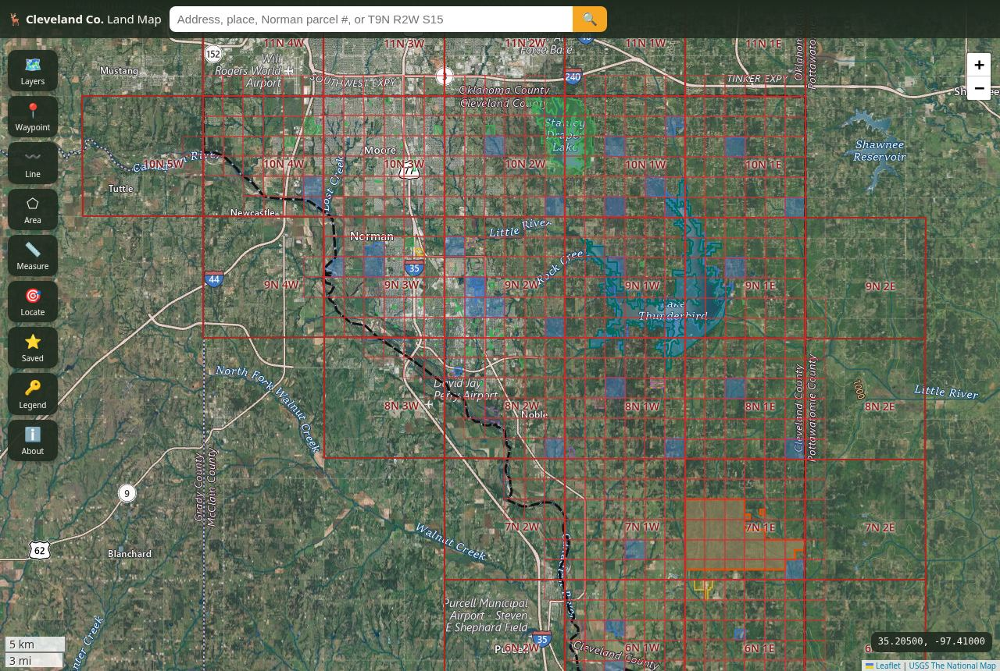

# Cleveland County Land Map — an onX-style map for Cleveland County, Oklahoma

A free, open-source, **onX Hunt-style** web map for **Cleveland County, Oklahoma** (Norman, Moore, Noble,
Lexington, Little Axe, Lake Thunderbird; FIPS 40027) built **only on public data**. Static site — Leaflet + vanilla
JS, no build step, **no API keys**.



## Features

- **Basemaps:** USGS Imagery (NAIP-based), USGS Imagery + Topo hybrid, USGS Topo, Esri World Imagery, OpenStreetMap.
- **Public land:** USGS **PAD-US 4.1** (federal / state / local / NGO / easements, with public-access code),
  **ODWC Wildlife Management Areas** (Lexington WMA), ODWC WMA facilities (parking, entrances, shooting ranges,
  camping, boat ramps, WMA roads), **Lake Thunderbird State Park**, **BOR flowage easements** around Lake Thunderbird.
- **Parcels** (City of Norman) with click-to-identify: situs address, geo number (parcel ID), recorded + computed
  acreage, land use, school district, addition/block/lot, FEMA LOMC. Link-out to the Cleveland County Assessor.
- **PLSS** townships & sections (BLM CadNSDI) with labels; click shows `Sec 15, T9N R2W, Indian Meridian`.
- **County boundary**, **NHD hydrography**, **USGS contours**, **3DEP hillshade**, **road & place labels**.
- **Click anywhere:** lat/lon, DMS, **MGRS**, **elevation** (USGS EPQS), PLSS location, every public/protected
  land unit under the point, parcel info, “save as waypoint”, directions link.
- **Search:** addresses/places (OSM Nominatim, limited to the county), Norman parcels by address or geo number,
  PLSS (`T9N R2W S15`, `9N 2W 15`), public-land unit names, `lat, lon`, MGRS.
- **Waypoints, lines, areas** saved in `localStorage`; rename/notes/delete; **export GPX or GeoJSON**; import GPX/GeoJSON.
- **Measure** distance and area. **Locate me** (GPS watch with accuracy circle).
- Coordinate readout (click to cycle decimal / DMS / MGRS), legend, sources & disclaimer, URL hash keeps the view.
- Mobile layout (bottom toolbar, bottom-sheet panels).

## Run locally

```bash
python3 -m http.server 8080        # or: npx http-server -c-1 -p 8080 .
# open http://localhost:8080
```

Opening `index.html` directly from disk (`file://`) will not work because the app `fetch()`es `data/*.geojson`.

## Deploy (GitHub Pages)

`.github/workflows/pages.yml` publishes the repo root on every push to `main`.
In the repo: **Settings → Pages → Build and deployment → Source: GitHub Actions**.

## Refresh the data

Small layers are pre-baked into `data/` (≈1.4 MB total) so the app is fast and works even if a source is slow.

```bash
npm install
npm run check-endpoints   # pings every live and refresh endpoint
npm run fetch-data        # re-downloads data/*.geojson from the sources below
```

`.github/workflows/refresh-data.yml` does this monthly and commits changes.
Smoke test (headless Chromium): `pip install playwright && playwright install chromium`, start a server, then
`python3 scripts/smoke_test.py http://localhost:8080/`.

## Data sources (all verified responding on 2026-10-27)

| Layer | Source | How used |
|---|---|---|
| Parcels (Norman) | City of Norman GIS — [Parcels FeatureServer/1](https://services.arcgis.com/rt1leD4Hj3sLGHNL/arcgis/rest/services/Parcels/FeatureServer/1) (46,379 parcels) | Live query (z ≥ 15 + click/search) |
| Owner / assessor records | [Cleveland County Assessor (Spatialest)](https://property.spatialest.com/ok/cleveland/) · [okco14.com](https://okco14.com/home.html) | Link-out only |
| Public & protected lands | USGS [PAD-US 4.1 Manager Name](https://services.arcgis.com/v01gqwM5QqNysAAi/arcgis/rest/services/Manager_Name_PADUS/FeatureServer/0) | Pre-baked, clipped to county |
| WMAs, state parks | [Oklahoma Recreational Areas FeatureServer](https://services6.arcgis.com/RBtoEUQ2lmN0K3GY/arcgis/rest/services/OklahomaRecreationalAreas/FeatureServer) (layers 0, 3) | Pre-baked |
| WMA facilities | ODWC [PublicWILMA/WILMAFeatures MapServer](https://www.wildlifedepartment.com/server/rest/services/PublicWILMA/WILMAFeatures/MapServer) | Pre-baked |
| PLSS | BLM [CadNSDI PLSS MapServer](https://gis.blm.gov/arcgis/rest/services/Cadastral/BLM_Natl_PLSS_CadNSDI/MapServer) (layers 1, 2) | Pre-baked |
| BOR flowage easements | City of Norman [BOR_Flowage_Easement_Parcels](https://services.arcgis.com/rt1leD4Hj3sLGHNL/arcgis/rest/services/BOR_Flowage_Easement_Parcels/FeatureServer/0) | Pre-baked |
| County boundary | Census [TIGERweb State_County/1](https://tigerweb.geo.census.gov/arcgis/rest/services/TIGERweb/State_County/MapServer/1) | Pre-baked |
| Topo / imagery / hillshade | USGS The National Map [basemap services](https://basemap.nationalmap.gov/arcgis/rest/services) | Live tiles (public domain) |
| Contours | USGS [contours MapServer](https://carto.nationalmap.gov/arcgis/rest/services/contours/MapServer) | Live export tiles |
| Hydrography | USGS [NHD MapServer](https://hydro.nationalmap.gov/arcgis/rest/services/nhd/MapServer) | Live export tiles |
| Elevation | USGS [EPQS](https://epqs.nationalmap.gov/v1/docs) | Live, on click |
| Street map, geocoder | © [OpenStreetMap](https://www.openstreetmap.org/copyright) contributors; [Nominatim](https://nominatim.org/release-docs/latest/api/Search/) | Live (respect usage policy: low volume) |
| Esri World Imagery & reference | © Esri, Maxar, Earthstar Geographics | Live tiles, attributed |

## Known limitations (read this)

- **No countywide parcel layer with owner names is publicly served.** The Cleveland County (OK) Assessor's map is
  a Spatialest web app with no documented public API, and the county's GIS page says it maintains only a parcel
  layer internally. The OKMaps/OGI statewide parcel layer is “view-only through WMS, not available for download”
  and its GeoServer was unresponsive during testing, so it is not included.
  → Parcels are shown **only inside Norman city limits** (City of Norman data), and **owner names are not shown**;
  use the Assessor link. Moore, Noble, Lexington and unincorporated areas outside Norman have no parcel lines here.
- Beware look-alikes: `gis.clevelandcounty.com` and several ArcGIS Online “Cleveland County Parcels” items are
  **Cleveland County, North Carolina** — not used.
- ODWC's own WMA boundary/regulation services require a token; WMA boundaries come from the public ODOT-hosted
  Oklahoma Recreational Areas service and PAD-US. No walk-in (OLAP) layer is available for this county.
- PAD-US “Open access” ≠ hunting allowed (city parks, state park). CLO (State Land Office) trust lands are
  generally leased and **not** open to public hunting. Always check ODWC regulations.
- Esri basemaps are provided for convenience under Esri's attribution terms; for heavy/commercial use, review
  Esri's terms or stick to the USGS basemaps (public domain).
- Not a survey; data can be outdated or misaligned. Verify ownership and get permission before entering land.

## Project layout

```
index.html            app shell
css/app.css           styles (desktop + mobile)
js/app.js             map, layers, identify, search, drawing, measure, export
js/geo.js             geometry helpers (distance, area, point-in-polygon, GPX)
data/*.geojson        pre-baked public layers (see table)
vendor/               Leaflet 1.9.4, mgrs 2.1.0
scripts/              fetch-data.mjs, check-endpoints.mjs, smoke_test.py
```

Not affiliated with onX Maps. MIT licensed (code only).
