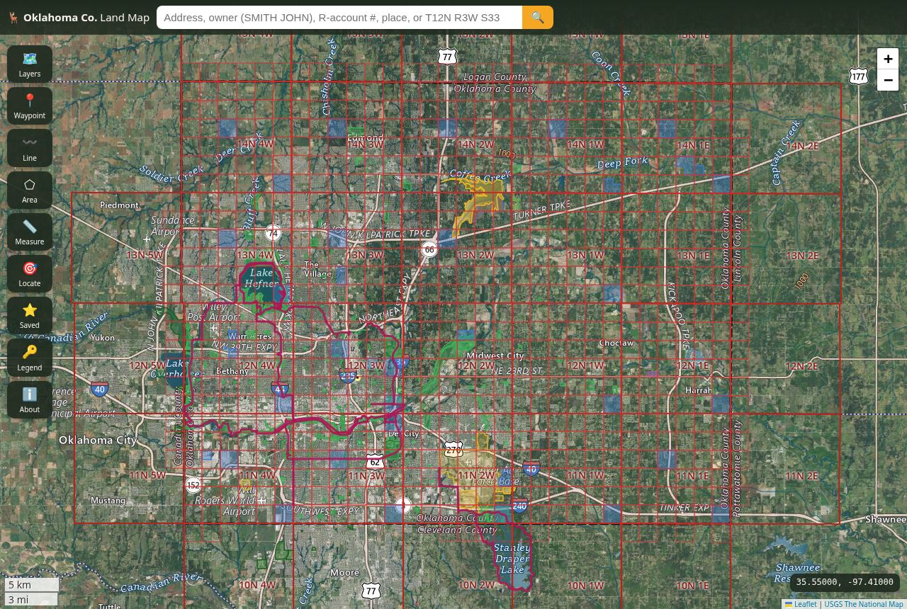

# Oklahoma County Land Map — an onX-style map for Oklahoma County, Oklahoma

A free, open-source, **onX Hunt-style** web map for **Oklahoma County, Oklahoma** (Oklahoma City, Edmond,
Midwest City, Del City, Bethany, Choctaw, Harrah, Jones, Luther, Arcadia; FIPS 40109) built **only on public data**.
Static site: Leaflet + vanilla JS, no build step, **no API keys**.



## Features

- **Countywide parcels with owner names** (Oklahoma County Assessor, 329,887 tax parcels). Clicking one shows:
  owner(s), owner mailing address, account #, PIN, account type, assessor acreage and computed area, situs
  address, legal description, subdivision/block/lot, assessor quarter/section/township/range, tax district,
  market/taxable/land value, and last sale year, price and validity. There's also a link to the Assessor's account page.
- **Search:** owner name (last name first, e.g. `SMITH JOHN`), situs address (`400 W CALIFORNIA`), real account
  (`R010017936`), PIN (`2730-01-001-7936`), places/addresses (OSM Nominatim, limited to the county), PLSS
  (`T12N R3W S33`), public-land names, `lat, lon`, MGRS.
- **Basemaps:** USGS Imagery, USGS Imagery + Topo, USGS Topo, Esri World Imagery, OpenStreetMap.
- **Public land:** USGS **PAD-US 4.1** clipped to the county, covering Lake Hefner, Lake Overholser and Lake Stanley Draper
  (recreation areas plus closed watershed buffers), Arcadia Lake (USACE: Edmond Park, Spring Creek Park), Martin Park
  Nature Center, Stinchcomb Wildlife Refuge, Oklahoma River tracts, Tinker AFB (closed), easements. Also the **ODWC
  Arcadia Conservation Education Area** with its facilities (entrance, parking, roads), plus **OKC city parks**
  (169), **OKC trails, trailheads and trail parking**.
- **PLSS** townships & sections (BLM CadNSDI, Indian Meridian) with labels, plus **county boundary**,
  **NHD hydrography**, **USGS contours**, **3DEP hillshade**, **road & place labels**.
- **Click anywhere:** lat/lon, DMS, **MGRS**, elevation (USGS EPQS), PLSS, public land under the point, parcel,
  save as waypoint, directions link.
- **Waypoints, lines, areas** saved in `localStorage`, with **GPX / GeoJSON export** and GPX/GeoJSON import. Also
  **measure** distance/area, **locate me**, coordinate readout (click to cycle decimal/DMS/MGRS), legend,
  disclaimer, and a mobile layout.

## Run locally

```bash
cd onx-oklahoma-county
python3 -m http.server 8080        # or: npx http-server -c-1 -p 8080 .
# open http://localhost:8080
```

`file://` won't work because the app `fetch()`es `data/*.geojson`. To deploy, use any static host. A GitHub
Pages workflow is included at `.github/workflows/pages.yml` (set Settings → Pages → Source: GitHub Actions).

## Refresh / test

```bash
npm install
npm run check-endpoints   # pings every live + refresh endpoint
npm run fetch-data        # rebuilds data/*.geojson (~2 MB)
pip install playwright && playwright install chromium
python3 -m http.server 8080 & python3 scripts/smoke_test.py http://localhost:8080/
```

`.github/workflows/refresh-data.yml` refreshes the data monthly.

## Data sources (verified responding 2026-10-27)

| Layer | Source | How used |
|---|---|---|
| Tax parcels + owners | Oklahoma County Assessor, [Property_Information MapServer/3 "Tax Parcels"](https://okassessor.oklahomacounty.org/server/rest/services/OnlineMapping/Property_Information/MapServer/3) | Live query (draw at z ≥ 15, click, search) |
| Assessor account pages | [docs.oklahomacounty.org AssessorWP5](https://docs.oklahomacounty.org/assessorwp5/DefaultSearch.asp) (`AN-R.asp?PropertyID=`) | Link-out |
| Public & protected lands | USGS [PAD-US 4.1 Manager Name](https://services.arcgis.com/v01gqwM5QqNysAAi/arcgis/rest/services/Manager_Name_PADUS/FeatureServer/0) | Pre-baked, clipped to county |
| OKC parks, trails, trailheads, trail parking | City of OKC Open Data [Recreation_Parks FeatureServer](https://utility.arcgis.com/usrsvcs/servers/1e65b61d07f5458a90d4cfa01e882044/rest/services/OpenData/Recreation_Parks/FeatureServer) (layers 1–4) | Pre-baked |
| ODWC areas | [Oklahoma Recreational Areas FeatureServer/0](https://services6.arcgis.com/RBtoEUQ2lmN0K3GY/arcgis/rest/services/OklahomaRecreationalAreas/FeatureServer) | Pre-baked |
| ODWC area facilities | ODWC [PublicWILMA/WILMAFeatures](https://www.wildlifedepartment.com/server/rest/services/PublicWILMA/WILMAFeatures/MapServer) | Pre-baked |
| PLSS | BLM [CadNSDI PLSS](https://gis.blm.gov/arcgis/rest/services/Cadastral/BLM_Natl_PLSS_CadNSDI/MapServer) | Pre-baked |
| County boundary | Census [TIGERweb State_County/1](https://tigerweb.geo.census.gov/arcgis/rest/services/TIGERweb/State_County/MapServer/1) (GEOID 40109) | Pre-baked |
| Topo / imagery / hillshade | USGS [The National Map basemaps](https://basemap.nationalmap.gov/arcgis/rest/services) | Live tiles |
| Contours / hydrography | USGS [contours](https://carto.nationalmap.gov/arcgis/rest/services/contours/MapServer), [NHD](https://hydro.nationalmap.gov/arcgis/rest/services/nhd/MapServer) | Live export tiles |
| Elevation | USGS [EPQS](https://epqs.nationalmap.gov/v1/docs) | Live, on click |
| Street map / geocoder | © [OpenStreetMap](https://www.openstreetmap.org/copyright) contributors; Nominatim | Live, low volume |
| Esri imagery & reference | © Esri, Maxar, Earthstar Geographics | Live tiles, attributed |

## Known limitations

- **Owner data is the Assessor's tax roll**, not a title record. It can lag recorded deeds, uses "last name first"
  and abbreviations (e.g. `CITY OF OKLA CITY`). Verify with the County Clerk for anything legal.
- **Parcels need zoom ≥ 15** to draw, and one view loads at most 2,000 parcels. The Assessor server is a county
  production server, so expect 0.5–1.5 s per query. If it's down, parcel lines and owner lookup stop working (the
  rest of the map still works).
- Sale "date" in the parcel layer is a **year** only. Values are the current Assessor roll.
- Other Assessor services (ParcelFabric, Utilities) need a token and aren't used. The OKMaps/OGI statewide parcel
  WMS is view-only and was unresponsive during testing. It isn't needed because the county source is better.
- **No ODWC Wildlife Management Area is in Oklahoma County.** The only ODWC unit is the Arcadia Conservation
  Education Area, which has special rules and is mostly closed to hunting. Hunting inside city limits (most of the
  county) is restricted by ordinance. PAD-US "Open access" means public access, **not** that hunting is allowed.
  The lake "WPA" polygons (Hefner, Overholser, Draper) are closed watershed buffers.
- PAD-US has no state parks in the county. Some PAD-US units (e.g. the BLM "Oklahoma Field Office" and CLO trust
  lands) are statewide multipolygons clipped to the county, and CLO trust land is generally **not** open to the public.
- USGS EPQS elevation was slow (10–30 s, one 504) during testing. The app shows "n/a" if it fails.
- PLSS townships/sections that only partly overlap the county are shown in full.
- Esri basemaps are for convenience under Esri attribution terms. The USGS basemaps are public domain.
- Not a survey, not legal advice. Verify ownership and get permission before entering land.

## Layout

```
index.html  css/app.css  js/app.js (map, layers, identify, search, draw, export)  js/geo.js (geometry, GPX)
data/*.geojson (pre-baked public layers)  vendor/ (Leaflet 1.9.4, mgrs 2.1.0)  scripts/ (fetch, check, smoke test)
```

Not affiliated with onX Maps or Oklahoma County. Code is MIT licensed. Data remains under each provider's terms.
